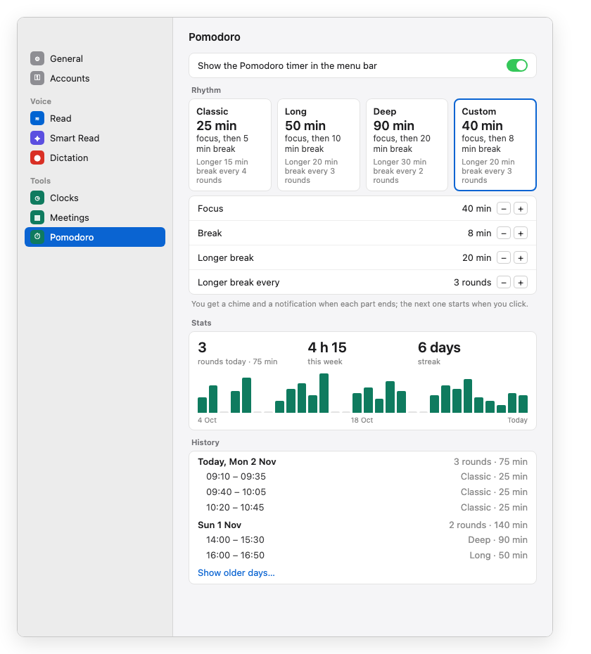

# Design: Pomodoro pane in Settings

Generated 2026-11-02, follows [focus-timer.md](focus-timer.md) (shipped in #25).
Branch: pomodoro-settings-pane
Status: APPROVED (layout, Rhythm cards with Custom, the name "Pomodoro")

## Problem

The focus timer shipped as a menu bar item with a popup and one toggle in Settings > General.
There was nowhere to see the whole history, and the preset dropdown
("Classic · 25 / 5, long 15 after 4") read like a code.

## Decisions

- **Name: Pomodoro.** Everything a person reads says "Pomodoro": the Settings pane, the
  VibeFlow menu, the notification titles where it fits, and the CHANGELOG. Code types can stay
  `Focus*`, because renaming them would only churn the code. "Focus" stays as the name of the
  work phase ("Start focus").
- **A Settings pane under Tools**, after Keep Awake: `SettingsTab.pomodoro`, a timer symbol,
  and the shared tools colour. General drops its Focus section.
- **No menu bar item until a session runs** (user, 2026-11-02: "only visible if we have a
  timer running, the control should all come from the app"). Pomodoro works like Keep Awake:
  it starts from VibeFlow menu > Pomodoro (status, the buttons for the current state, the
  rhythm, "Pomodoro Settings…") or from the pane's Session section. The timer item appears
  while a session is running, paused or waiting for a click, and leaves on Stop. The
  `focus.enabled` setting and its toggle are gone. One `PomodoroControls` view supplies the
  buttons for the menu, the pane and the running item's popup.
- **Rhythm cards instead of a dropdown.** There are four cards: Classic, Long, Deep and
  Custom. Each shows the focus length in large type, then the break in plain words ("focus,
  then 5 min break"), then "Longer 15 min break every 4 rounds". The popup's preset picker
  uses the same wording, as a compact menu. "Blocks" becomes "rounds" everywhere a person
  reads it.
- **Custom** (moved forward from TODOS.md at the user's request). Selecting the Custom card
  shows four steppers below the cards, in the same words: Focus (5 to 180 min, steps of 5),
  Break (1 to 60 min), Longer break (5 to 60 min, steps of 5), and Longer break every (1 to
  8 rounds). The values persist even while another card is selected. A change applies from
  the next phase, like any preset change.
- **Stats**: rounds and minutes today, this week, a streak, and a 30-day bar chart of focus
  minutes per day (Swift Charts). The streak counts days in a row with at least one round,
  ending today or yesterday, so it doesn't break before you've had a chance to start today.
- **History**: rounds grouped by day, newest first, with each day's total, then
  "Show older days…" (14 days at first, then 14 more per click). A round shows its time
  range, its rhythm and its minutes. Right-click > Delete removes a round logged by mistake.
  This is a FocusLog write, so the save-then-commit rule applies.
- **Rollover**: the pane reads the per-minute clock, the same one the popup uses, so "today"
  and the streak roll over at midnight.

## Engineering notes

- `FocusPreset` becomes a rhythm with four cases. `custom` reads its values from
  Preferences (`focus.custom.focus`, `.break`, `.longBreak`, `.rounds`). The session already
  snapshots the preset of each running round; it now also snapshots the rhythm's minutes,
  so editing Custom mid-round doesn't change the round that is running. A logged round keeps
  `minutes`, so the stats stay right after later edits.
- Decoding stays compatible: existing `focus.json` files hold `classic`, `long` and `deep`.
- New pure functions in FocusStats, with tests: `streak(blocks, now, calendar)`,
  `days(blocks, last: 30)`, `history(blocks, days:)`. A new FocusLog operation, tested:
  `delete(id)`.
- The Settings sidebar grows to eight rows, the last pane in Tools. Settings otherwise stays
  as minimal as before: the session buttons, the cards, and the Custom steppers only when Custom is
  picked.

## Next steps

1. Core: the rhythm with Custom, the snapshot of round minutes, streak, 30-day and history
   grouping, and delete. Tests in FocusTests.swift.
2. App: the `PomodoroPane` (session, cards, steppers, stats, history), the sidebar row, the
   General section removed, the popup wording ("rounds", plain rhythm text), and the name
   "Pomodoro".
3. Remove the Custom preset entry from TODOS.md, now that it is built.
4. Run `swift test`, the Debug build, and `scripts/dev.sh` to check the pane by hand.
